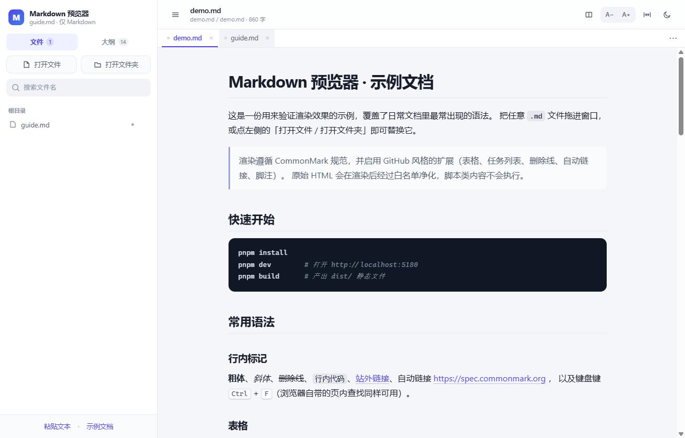

# Markdown 预览器

双击就能看的本地 Markdown 阅读器：不经过浏览器，也不需要先起服务。纯本地运行、不上传任何文件。

改完文件它自己刷新；想改两笔，切到双栏就能就地编辑并保存。



## 快速开始

### 桌面版（双击打开）

```bash
pnpm install
node node_modules/electron/install.js   # pnpm 10 默认跳过构建脚本，Electron 二进制要手动装
pnpm dist        # 打包到 release/MarkdownPreview/
```

然后双击 `release/MarkdownPreview/MarkdownPreview.exe`。
想双击 `.md` 直接打开，再跑一次 `pwsh -File scripts\associate-md.ps1 -SetDefault`。

详见[桌面版文档](docs/06-desktop/桌面版.md)。

### 网页版

```bash
pnpm dev         # http://localhost:5180
```

没准备文档？打开 <http://localhost:5180/?demo=1> 直接看内置示例。

构建静态产物：`pnpm build` → `dist/`，任意静态服务器可托管。

## 文档地图

按角色查，不用从头读：

| 文档 | 内容 | 什么时候看 |
| --- | --- | --- |
| [需求文档](docs/01-requirements/需求文档.md) | 范围、用户场景、18 条功能需求与验收标准、非功能指标 | 想知道「做了什么、没做什么」 |
| [原型说明](docs/02-prototype/原型说明.md) · [交互原型](docs/02-prototype/prototype.html) | 可点击静态原型 + 布局决定的理由 | 想改界面，先看当初为什么这么排 |
| [设计文档](docs/03-design/设计文档.md) | 架构、12 个关键技术决策、状态模型、安全模型、性能预算 | 想理解技术选型 |
| [实现说明](docs/04-implementation/实现说明.md) | 目录结构、模块职责、接口契约、10 条踩坑记录 | 要改这份代码 |
| [使用说明](docs/05-manual/使用说明.md) | 安装、四种打开方式、双栏、快捷键、常见问题 | 只是要用它 |
| [桌面版](docs/06-desktop/桌面版.md) | 双击运行、打包、文件关联、IPC 结构、与网页版的差异 | 想装到本机用 |
| [开源前检查](docs/07-open-source/开源前检查.md) | 隐私/敏感信息扫描结果、发布前清单、运行时数据位置 | 准备开源 |
| [方案图](docs/proposal/) | 架构、渲染管线、界面草图、v1.1 选型对比 | 需要对外讲解 |

## 能力一览

- **两种形态**：**桌面应用（双击运行、可关联 .md）** / 网页版（零安装）
- **输入**：拖拽文件 / 拖拽目录 / 文件选择器 / 目录授权 / 粘贴文本 / **命令行参数**
- **浏览**：多标签页、**刷新后恢复会话**、**批量关闭**、按目录分组、文件名搜索、大纲联动、已打开标记
- **解析**：CommonMark 0.31 + GFM（表格、任务列表、删除线、自动链接、脚注）
- **渲染**：24 种语言代码高亮、Mermaid 图表、**KaTeX 数学公式**、相对路径图片
- **磁盘协作**：**改动自动刷新**、**双栏编辑 + 滚动同步 + 保存回写**
- **阅读**：深浅主题、三档字号、两种阅读宽度、打印样式
- **安全**：渲染后 DOMPurify 白名单净化，脚本 / 内联样式 / 危险协议全部拦截

## 技术栈

| 层 | 选择 |
| --- | --- |
| 构建 | Vite 8 + React 19 + TypeScript（严格模式） |
| 解析 | markdown-it 15（+ footnote / task-lists / anchor） |
| 净化 | DOMPurify |
| 高亮 | highlight.js（常用 24 种语言） |
| 图表 / 公式 | Mermaid、KaTeX（均动态 import，不进首屏） |
| 文件 | File System Access API（浏览器）/ Electron IPC（桌面）；句柄或路径存 IndexedDB 以恢复会话 |
| 样式 | 原生 CSS + 自定义属性，无 UI 框架 |

首屏约 **180 KB gzip**，首次内容绘制约 **180 ms**。

## 目录结构

```
md-preview/
├─ src/            应用源码（lib 负责算法，components 负责界面）
├─ electron/       桌面壳：主进程与预加载脚本
├─ scripts/        打包与 .md 文件关联
├─ tools/          开发期验证脚本（CDP 截图 + DOM 断言）
├─ docs/           需求 / 原型 / 设计 / 实现 / 使用 / 桌面 / 开源检查
├─ dist/           构建产物（不入库）
└─ package.json
```

## 隐私

- **不联网**：没有分析、没有遥测、没有远程字体；Mermaid、KaTeX、highlight.js 全部随包构建
- **文件只在本机处理**：网页版走浏览器文件 API，桌面版走 Electron 主进程读写
- **本地会存这些**（都可一键清除）：

| 位置 | 内容 |
| --- | --- |
| `localStorage` | 主题、字号、阅读宽度 |
| `IndexedDB`（`md-preview`） | 上次打开的文件句柄、滚动位置 |
| 桌面版 `%APPDATA%\Markdown 预览器` | 窗口状态与缓存 |

清除方式：浏览器里清除站点数据；桌面版删掉上述文件夹即可。

完整的开源前自查记录见[开源前检查报告](docs/07-open-source/开源前检查.md)。

## 状态

v1.3 —— 桌面版上线，需求中的 23 条功能需求全部实现并通过验收。

已知限制与后续计划见[需求文档第 7 节](docs/01-requirements/需求文档.md)：拖拽打开的文档无法监听也无法恢复、Safari/Firefox 无目录授权、极端大文档偏慢、桌面版体积约 337 MB。

## 许可

[MIT](LICENSE)
