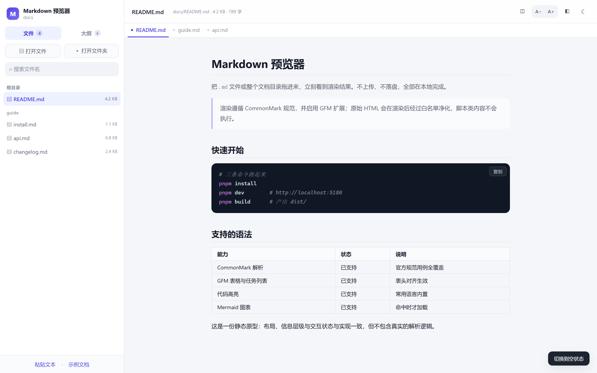

# 原型说明

> 文件：[prototype.html](./prototype.html)（双击即可在浏览器打开，无需安装任何东西）

## 1. 这份原型是什么

一份**静态可交互原型**，用来在写代码之前把三件事定下来：

1. **布局**：屏幕被切成哪几块，各占多少
2. **信息层级**：什么该在第一时间被看到，什么应该收起来
3. **状态**：空状态、加载、阅读、出错，各长什么样

它不是产品代码：没有 Markdown 解析、没有文件读取，所有内容都是写死的假数据。真实实现见 [`src/`](../../src/)。

## 2. 怎么玩

| 操作 | 结果 |
| --- | --- |
| 点「文件 / 大纲」 | 侧栏在文档列表与标题大纲之间切换 |
| 点文件名 | 切换当前选中项（模拟跨文档跳转） |
| 点标签条 | 在三个已打开的文档之间切换（模拟标签页） |
| 点工具栏最左侧的「◫」 | 切换阅读 / 双栏编辑形态 |
| 点大纲条目 | 切换当前高亮小节 |
| 右下角「切换到空状态」 | 在阅读态与首次进入的空状态之间来回看 |

## 3. 原型固定下来的设计决定

| 决定 | 理由 |
| --- | --- |
| **左侧固定 300px 侧栏** | 目录场景下面包屑比正文更重要；固定宽度让长文件名有稳定的截断位置 |
| **侧栏分「文件 / 大纲」两个标签** | 文档多时，两者都长，挤在一列会让大纲被顶到屏幕外 |
| **正文单列、最大 720px** | 中文阅读的最舒适行宽；需要时可用工具栏切到宽版 |
| **工具栏只放阅读相关开关** | 主题、字号、宽度是「读」的参数；打开文件属于「找」，放在侧栏 |
| **空状态是一个卡片，不是一片空白** | 第一次进入必须回答「我能干什么、怎么开始」 |
| **空状态给两个入口 + 两个次入口** | 主路径是文件/文件夹；示例与粘贴是降低试错成本的旁路 |
| **代码块始终深色** | 明暗主题下代码的辨识度都稳定，避免浅色代码块在暗色页面里刺眼 |
| **标签条放在工具栏下方，而不是侧栏里** | 标签表达的是「当前工作集」，与「有哪些文件」是两件事；放在顶部才有明显的位置感 |
| **双栏是切换而不是常驻** | 多数时候只需要读；编辑是低频动作，不该永久压缩阅读宽度 |

## 4. 与实现的差异

| 原型 | 实现 | 说明 |
| --- | --- | --- |
| 假数据 | 真实读取本地文件 | 数据来源不同，视觉一致 |
| 图标用字符占位 | 统一的 16px 线性 SVG 图标 | 见 `src/components/Icon.tsx` |
| 大纲高亮靠点击切换 | IntersectionObserver 跟随滚动 | 交互深度不同 |
| 无加载态 | `loading` 状态有占位文案 | 本地读取太快，通常一闪而过 |
| 无错误态 | 读取失败/非 Markdown 有明确提示 | 见 `EmptyState` 与 toast |
| 无「⋯」批量关闭菜单 | 标签右侧的关闭其他 / 全部关闭 | 原型只到布局层面，菜单是实现期补的 |
| 无刷新恢复 | 顶部「恢复会话」提示条 | 与浏览器授权交互强相关，不适合画进静态原型 |

## 5. 为什么保留这份原型

- 需求评审时，大家对着同一张图说话，比对着文字描述争论有效
- 后续改版时，能一眼看出「当初为什么这么排」，避免反复推翻
- 它是一份可以脱离构建工具打开的「设计快照」，发给非技术同事也能看
