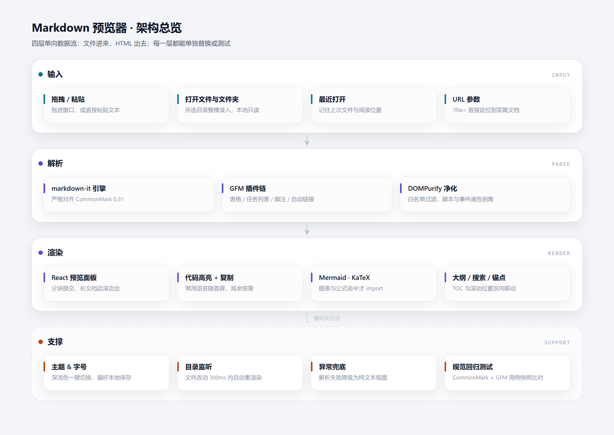
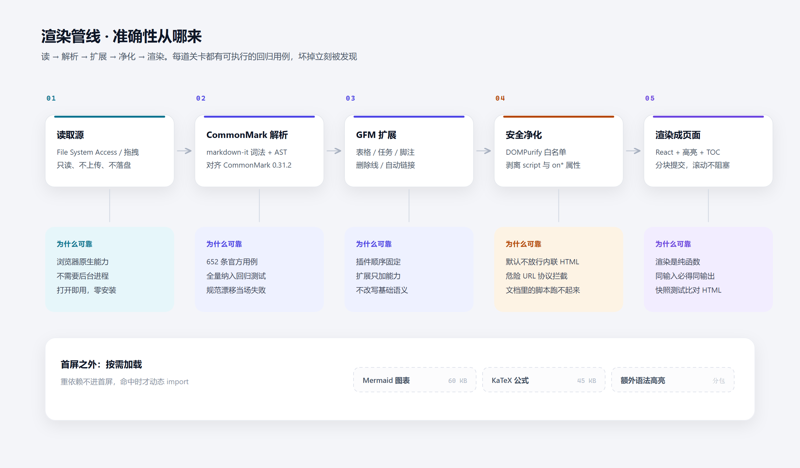

# 设计文档

> 适用版本：v1.3 · 最后更新：2026-10-23

## 1. 设计目标

| 目标 | 具体的约束 |
| --- | --- |
| **快** | 纯静态、无后端；首屏只装解析核心，公式与图表按需加载 |
| **准** | 解析交给 CommonMark 参考实现；扩展只加能力，不改基础语义 |
| **安全** | 原始 HTML 允许显示，但必须过白名单；不允许脚本、内联样式、危险协议 |
| **顺手** | 改完就能看到、看到就能改；不为了「改一行」去切换窗口 |
| **可换** | 文件来源抽象成 `Library`，换来源不动渲染，换渲染不动文件 |

## 2. 总体架构



五层单向数据流，任何一层都可以单独替换：

| 层 | 职责 | 落在哪 |
| --- | --- | --- |
| 输入层 | 拿到文件：目录句柄 / 文件句柄 / 拖拽 / 粘贴 | `lib/files.ts`、`App.tsx` |
| 监听层 | 轮询句柄的 `lastModified`，变化则重读 | `App.tsx`（`WATCH_INTERVAL`） |
| 解析层 | Markdown → 干净 HTML（含源码行号与公式占位） | `lib/markdown.ts`、`lib/highlight.ts` |
| 渲染层 | HTML → 页面，并做四项后置增强 | `components/DocumentView.tsx` |
| 编辑层 | textarea + 镜像量尺 + 双向滚动映射 | `components/Editor.tsx`、`lib/useScrollSync.ts` |
| 界面层 | 标签页、布局、状态、偏好 | `App.tsx`、`components/*`、`styles/*` |

## 3. 关键决策

### 3.1 解析用 markdown-it，不用 react-markdown

| 方案 | 符合度 | 速度 | 结论 |
| --- | --- | --- | --- |
| **markdown-it 15** | 通过 CommonMark 0.31 全套用例 | 快，单次解析毫秒级 | **采用** |
| react-markdown（remark/rehype） | 符合度也高 | 中间层多，重建 AST 开销大 | 备选 |
| marked | 符合度也高，但 GFM 边角有差异 | 最快 | 不选 |

代价：需要自己做安全净化，并使用 `dangerouslySetInnerHTML`。换来的是解析速度与插件生态。

### 3.2 允许原始 HTML，靠净化兜底

`html: false` 最安全，但会毁掉大量真实文档：`<details>`、`<kbd>`、`<p align="center">` 全都变成纯文本。

因此选择 **先渲染、再净化**：

```
Markdown 原文 → markdown-it（html: true） → HTML 字符串 → DOMPurify 白名单 → 插入 DOM
```

净化策略（`lib/markdown.ts`）：

- 禁止标签：`script` `style` `iframe` `object` `embed` `form` `link` `meta` `base`
- 禁止属性：`style` 与全部 `on*`
- 允许 `target` / `rel` / `align` / `colspan` 等排版属性

### 3.3 表格对齐用 class，不用内联 style

markdown-it 用 `style="text-align:center"` 表达对齐，正好撞上「禁止 style」。这里不为对齐开例外——一旦允许 `style`，CSS 注入面就重新打开。

做法：改写 `th_open` / `td_open`，把对齐信息搬成 `align-center` 等 class，再把 `style` 整个删掉。

### 3.4 Mermaid 与 KaTeX 都走「占位 + 懒加载」

两者体积都远大于应用本体（KaTeX 连同字体约 1 MB），且只出现在少数文档里：

```
markdown-it 输出占位元素（data-tex / pre.mermaid-src）
        ↓  挂载后检测到占位
动态 import 渲染器 → 原地渲染
```

首屏因此只有 180 KB（gzip）。代价是图表与公式有一瞬间的占位态，失败时必须给明确提示（已实现）。

### 3.5 文件监听用轮询，不用 `fs.watch`

浏览器没有 `fs.watch`；`FileSystemObserver` 目前仍是实验能力。可靠的做法是：

- 每隔 900 ms，对**已打开的标签**调用一次 `handle.getFile().lastModified`
- 只有 `mtime` 变了才重读并重渲染
- 页面不可见（`visibilityState !== 'visible'`）时暂停
- 有未保存修改时不覆盖，只提示「磁盘已更新」

代价：最坏有 900 ms 的延迟。换来的是跨浏览器可预期，且开销极低（只读元数据，不读全文）。

### 3.6 拖拽/普通选择器打开的文件不能监听

`File` 对象是**快照**，磁盘再变它也不会变。只有 `showOpenFilePicker` / `showDirectoryPicker` 拿到的**句柄**才能重新读取。

因此两条路径并存：

| 路径 | 能看 | 能监听 | 能保存 |
| --- | --- | --- | --- |
| 拖拽 / `<input type=file>` | ✅ | ❌ | ❌ |
| 目录/文件句柄（Chrome/Edge） | ✅ | ✅ | ✅ |

界面上不做隐瞒：拖入后会提示「该模式不支持自动刷新」。

### 3.7 双栏同步用「镜像量尺 + 源码行号」

textarea 会软换行，一个源码行可能占多个屏幕行，不能简单按行高换算。

- **行号**：markdown-it 的每个块级 token 都有 `map`（起止行），渲染时写成 `data-line`
- **量尺**：编辑器旁挂一个同样式、同宽度的隐藏镜像 `div`，每个源码行一个子元素；读它们的 `offsetTop` 就得到每行的真实像素位置
- **双向映射**：编辑器滚动 → 顶行行号 → 找 `data-line ≤ 行号` 的最后一个块 → 滚过去；反向同理

另加 120 ms 的「驱动锁」，避免 A 滚 B、B 又回滚 A 的抖动。

### 3.8 标签页各自持有读取闭包

标签里存的不是「当前文档路径」，而是一组闭包：`read()` / `stat()` / `write()` 和所属的 `Library`。

好处：之后即使又打开了另一个目录，旧标签仍然可读、可保存（它认识自己的来源）。代价是这些 `Library` 在会话期间不能释放，卸载时统一 `dispose()`。

### 3.9 会话存在 IndexedDB，句柄原样存进去

刷新后要恢复标签，必须持久化**文件句柄**——`FileSystemHandle` 是结构化可克隆对象，可以直接放进 IndexedDB，路径字符串则不行（没有句柄就再也读不到那个文件）。

- 只存有 `origin` 的标签：目录/文件句柄、示例文档；拖拽与粘贴的标签不存（快照恢复不了）
- 存 `{ kind, handle, path, rootName, scrollTop, activeId }`，恢复时按 `kind + rootName` 分组，每组重建一次 `Library`（一次目录扫描），再逐个 `openTab`
- 写盘时机：标签或当前文档变化后延迟 800 ms 写一次；另外监听 `pagehide` 与 `visibilitychange`，保证滚动位置这种高频状态也能落盘
- 权限：句柄能存，授权不能存。刷新通常仍是 `granted`；浏览器重启后会变成 `prompt`，此时不静默失败，而是顶部出一条「恢复」提示，等用户点一下再 `requestPermission`

### 3.10 批量关闭只做两个动作

标签多了以后，逐个点 `×` 很烦。这里只提供「关闭其他」与「全部关闭」，不做「关闭左侧/右侧」这类需要解释的规则——两个动作覆盖 95% 的场景，且不需要用户学习。

关闭时不提示「有未保存修改」，因为**未保存内容不会被丢弃**：关闭只是把标签从工作集移除，磁盘文件本来就是最后保存的版本。真正需要保护的是「已修改」→ 这一点用标签上的脏点持续提示。

### 3.11 不用路由、不用状态库

一个页面、若干标签、一份偏好。引入路由或全局状态只会增加阅读成本。

- 页面级状态：`useState`
- 跨组件通信：props 下传 + 稳定回调上抛
- 持久化：只有偏好进 `localStorage`

### 3.12 桌面壳选 Electron，界面代码零改动

需求从「打开快」变成「双击就能进」之后，浏览器不再是入口，需要一个原生进程。

| 方案 | 双击可用 | 前置条件 | 体积 |
| --- | --- | --- | --- |
| **Electron** | 是 | 只要 npm | ~337 MB |
| Tauri | 是 | Rust 工具链 + MSVC | ~10 MB |
| PWA | 否 | — | — |

本机没有 Rust 工具链，装一套并等编译的成本远超收益；而 Electron 可以直接复用现有 dist/。

关键点：**界面层完全没改**。文件访问早就收敛在 Library 接口后面，桌面版只是新增了一个实现（libraryFromDesktop），把「读 / 写 / stat / 解析图片」换成 IPC 调用。

安全边界：contextIsolation: true、nodeIntegration: false，渲染进程只能看到 preload 暴露的那几个方法；站外链接交给系统浏览器。

打包也没有引入 electron-builder：Electron 只要求 exe 同级存在 resources/app，复制运行时 + 放入界面即可，省掉一整套下载依赖。

## 4. 渲染管线与降级策略



每一道关卡都有明确的失败姿态，保证「一处出错不影响整页」：

| 阶段 | 失败会怎样 | 现在的处理 |
| --- | --- | --- |
| 读取文件 | 被占用 / 已删除 | toast 提示，标签保持原样 |
| Markdown 解析 | 语法再怪也不会抛错 | — |
| 代码高亮 | 语言未注册 / 高亮器异常 | 退化为纯文本 |
| 安全净化 | 净化器异常 | 整体降级为纯文本视图（`raw-fallback`） |
| 图片解析 | 相对路径找不到 | 虚线占位框 |
| Mermaid 渲染 | 语法错误 | 该位置显示错误信息，其余正文不受影响 |
| KaTeX 渲染 | 公式语法错误 | `throwOnError: false`，显示红色原文 |

## 5. 状态模型

### 5.1 标签页

```ts
interface Tab {
  id: string          // `${rootName}::${path}`
  path: string
  name: string
  lib: Library        // 自己的来源，用于解析相对图片
  text: string        // 当前内容（可能被编辑）
  savedText: string   // 读盘或保存时的内容，用来算脏状态
  html: string        // 渲染结果
  mtime: number       // 用于监听比对
  read / stat? / write?
}
```

- 脏状态 = `text !== savedText`，不额外存布尔值，天然自洽
- 滚动位置存在 `Map<tabId, number>` 里（ref，不触发渲染）
- 编辑时先更新 `text`，140 ms 后再重算 `html`，避免每个按键都重新解析整篇

### 5.2 视图

`read`（单栏阅读）与 `split`（左源码 / 右预览）两种。切换时内容区重新挂载，滚动位置从 `Map` 恢复。

### 5.3 监听循环

```
每 900 ms
  ├─ 页面不可见 → 跳过
  ├─ 遍历有 stat 的标签
  ├─ mtime 未变 → 下一个
  ├─ 有未保存修改 → 提示，不覆盖
  └─ 重读 → 重渲染 → 更新 mtime
```

同一时刻只跑一轮（`watchBusy` 标记），避免慢磁盘下堆积任务。

### 5.4 会话持久化

```
启动 → loadSession()
        ├─ 无记录 → 空状态
        └─ 有记录 → 按 kind+rootName 分组
                     ├─ 重建 Library（目录扫描 / 单文件）
                     ├─ 逐个 openTab（含 scrollTop 回填）
                     └─ 失败（权限失效）→ 顶部「恢复」提示

变化 → 800 ms 防抖 → saveSession()
卸载 → pagehide → saveSession()（补上滚动位置）
```

数据库：`md-preview` / store `session` / 单键 `current`。版本号写进记录，结构不兼容时直接丢弃而不是硬迁移。

## 6. 安全模型

| 威胁 | 例子 | 对策 |
| --- | --- | --- |
| 脚本执行 | `<script>fetch('/steal')</script>` | DOMPurify 禁止 `script` |
| 事件处理器 | `` | 禁止全部 `on*` |
| 危险协议 | `[点我](javascript:alert(1))` | DOMPurify 默认 URI 白名单 |
| CSS 注入 | `style="background:url(http://…)"` | 禁止 `style` `link` `import` |
| 本地文件越权 | `` | 相对路径解析禁止 `..` 跳出根目录 |
| `data-*` 滥用 | 伪造 `data-line` / `data-tex` | v1.1 放开了 `data-*`（行号与公式需要）；最坏结果是错误的公式或滚动位置，不构成执行风险 |
| 写回越权 | 未经授权改写文件 | `createWritable` 由浏览器弹授权；未授权则抛错并提示 |
| 隐私泄露 | 文件内容被上传 | 全流程无网络请求；图片走 `blob:` |

## 7. 性能预算

实测环境：本机 Chrome（headless）、`vite preview` 本地静态服务。

| 项目 | 预算 | 实测 |
| --- | --- | --- |
| 首屏 JS（gzip） | ≤ 200 KB | 175.6 KB |
| 首屏 CSS（gzip） | ≤ 10 KB | 4.9 KB |
| 首次内容绘制 | ≤ 1.5 s | 180 ms |
| KaTeX（按需） | 不进首屏 | CSS 7.8 KB + JS 1.7 KB 拆分块，字体命中才下载 |
| 16 万字符文档 | < 200 ms | 85 ms |
| 85 万字符 / 1.4 万节点 | ≤ 1 s | 464 ms |
| 监听开销 | 可忽略 | 每 900 ms 只读元数据 |

**性能悬崖**：DOM 节点数比字节数更致命。9000 个标题 + 9000 个表格（18 万节点）约 10 秒，瓶颈在样式计算与布局。缓解手段是分块渲染，留到后续版本。

## 8. 可扩展点

| 想加什么 | 改哪里 |
| --- | --- |
| 新的 Markdown 语法 | `lib/markdown.ts` 的 `md.use(plugin)` 或新增 ruler |
| 新的文件来源（URL、Git 仓库） | 新增一个 `Library` 实现 |
| 标签页跨刷新保留 | 在 `App` 里把句柄写进 IndexedDB，启动时恢复 |
| 新的阅读排版 | `styles/markdown.css`（全部基于 CSS 变量） |
| 新的界面主题 | `styles/app.css` 顶部变量块 |
| 编辑器升级为 CodeMirror | 替换 `components/Editor.tsx`，同步逻辑接口不变 |

## 9. 与需求的对应

| 需求 | 设计上的落点 |
| --- | --- |
| FR-1 ~ FR-3 | `Library` 抽象；`scanDirectory` 只收 `.md` |
| FR-4 / FR-5 | markdown-it 默认预设 + footnote / task-lists |
| FR-6 | `highlight` 选项 + `pre.hljs` 后置复制按钮 |
| FR-7 / FR-8 | 占位 token + 动态 import（Mermaid / KaTeX） |
| FR-9 | `Library.resolveAsset()` + `blob:` URL |
| FR-10 | 渲染后从 DOM 采集标题 + IntersectionObserver |
| FR-11 | `prefs.ts` + CSS 变量 |
| FR-12 | `libraryFromText()` |
| FR-13 | DOMPurify 白名单（第 6 节） |
| FR-14 / FR-15 | `tabs` 数组 + 每个标签自带读取闭包 |
| FR-16 | 900 ms 轮询 `lastModified` |
| FR-17 | `writeDoc` + `createWritable` + 脏状态 |
| FR-18 | `data-line` + 镜像量尺 + 双向映射 |
