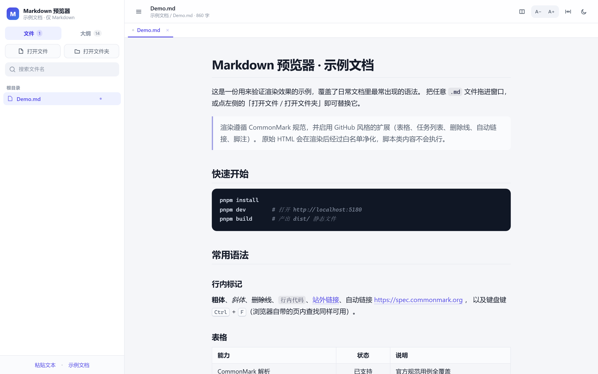
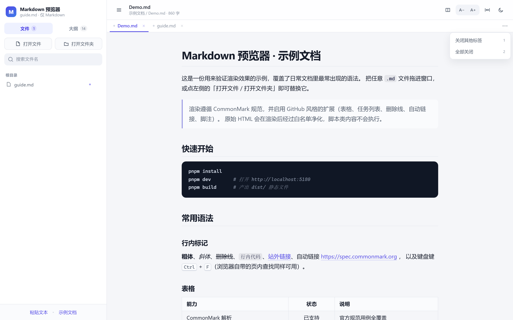
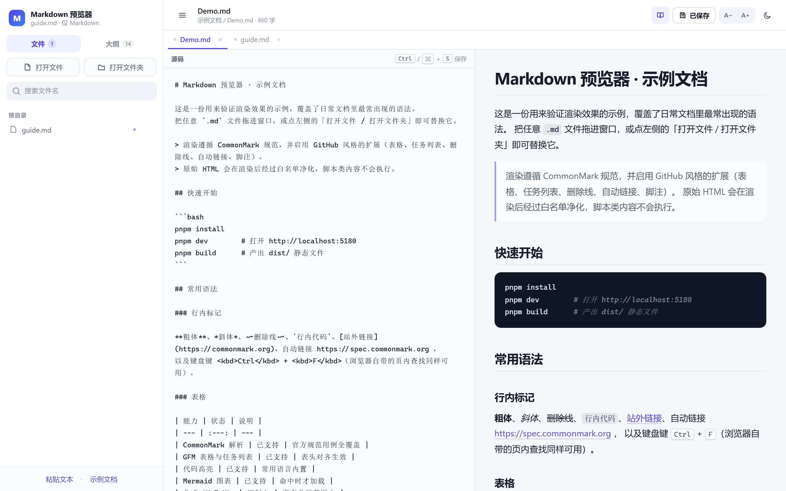
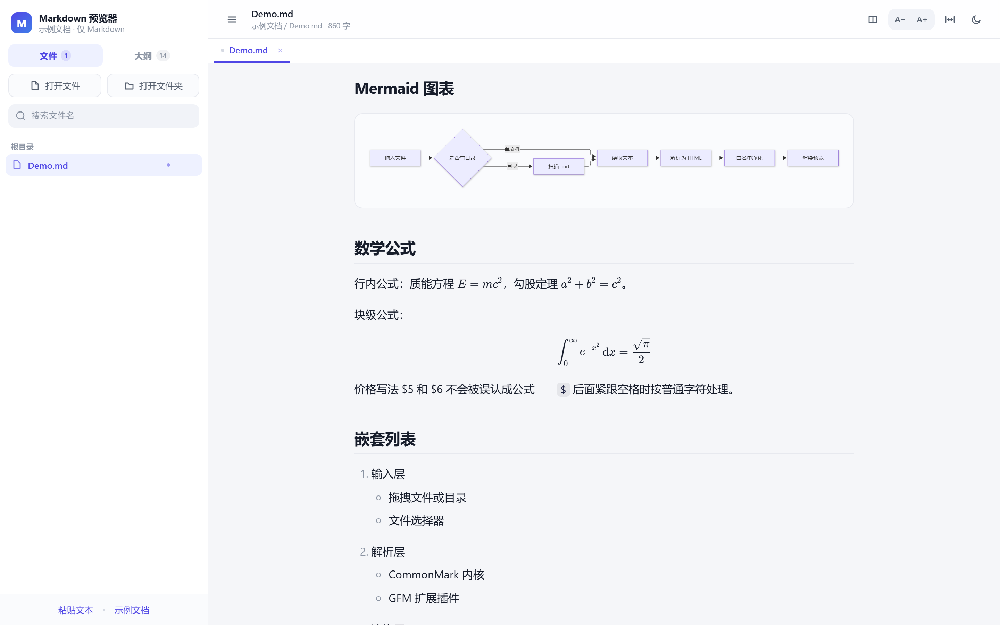

# 使用说明

> 面向使用者。只想尽快看到一份 Markdown 的话，看第 2 节就够了。

## 1. 需要什么

**桌面版（推荐）**：什么都不用装，拿到 `MarkdownPreview.exe` 双击即可。想自己打包才需要 Node.js 18+ 与 pnpm。

**网页版**：

- Node.js 18 或更高（推荐 20+）
- pnpm（`npm i -g pnpm`）
- 浏览器：Chrome / Edge 体验最完整（文件监听、保存需要）；Safari 16+ / Firefox 115+ 可以正常阅读，但没有目录监听与保存

不需要后端、不需要数据库、不需要联网（依赖装完之后，运行时完全不联网）。

## 2. 三种开始方式

### 桌面版：双击

```bash
pnpm install
pnpm dist        # 产出 release/MarkdownPreview/MarkdownPreview.exe
```

双击 exe 就能用；想双击 `.md` 直接打开，再执行一次：

```powershell
pwsh -File scripts\associate-md.ps1 -SetDefault
```

撤销关联：`pwsh -File scripts\associate-md.ps1 -Undo`。细节见[桌面版文档](../06-desktop/桌面版.md)。

### 网页版：三步跑起来

```bash
cd md-preview
pnpm install
pnpm dev
```

终端会打印地址，通常是 **http://localhost:5180**。

### 构建静态版本

```bash
pnpm build     # 产物在 dist/
pnpm preview   # 预览构建结果，默认 http://localhost:4173
```

## 3. 打开文档

| 方式 | 操作 | 能力 |
| --- | --- | --- |
| **打开文件夹** | 侧栏按钮，选一个目录（推荐） | 浏览整个 `docs/`，**自动监听改动**，可保存 |
| 打开文件 | 侧栏按钮 | 单篇；监听与保存同样可用 |
| 拖拽 | 把 `.md` 或整个文件夹拖进窗口 | 快速查看；**不支持自动刷新** |
| 粘贴 | 「粘贴文本」 | 临时看一段，不写文件 |

**打开文件夹时只会读取 Markdown**（`.md` / `.markdown` / `.mdown` / `.mkd`）。目录里的图片、代码、`node_modules` 不会出现在列表里；图片只在正文引用到它时才被读取。

第一次不想准备文件？点空状态里的「先看一份示例文档」，或访问 `http://localhost:5180/?demo=1`。

## 4. 界面



| 区域 | 内容 |
| --- | --- |
| 左侧栏 · 顶部 | 当前库的名字，标注「仅 Markdown」 |
| 左侧栏 · 文件 | 按目录分组；搜文件名；**已打开的文档右侧有一个小圆点** |
| 左侧栏 · 大纲 | 当前文档 h1–h4；滚动跟随；点击跳转 |
| 标签条 | 打开过的文档都在这里，点一下切回去；`×` 关闭；中键也能关 |
| 顶部工具栏 | 文件名、字数；双栏按钮、保存按钮、字号、宽度、主题 |
| 正文 | 单列排版，默认约 720px 宽，可切宽版 |

## 5. 多标签页

打开过的文档不会互相顶掉，而是排成标签：

- 同时开几篇都没问题，**每篇各自记住滚动位置**
- 切换回来时，内容和阅读位置都还在
- 有未保存修改的标签，前面会有个实心小点
- 关闭当前标签会自动切到相邻的那篇



**批量关闭**：点标签条右侧的「⋯」

| 菜单项 | 效果 |
| --- | --- |
| 关闭其他标签 | 只留当前这篇，其余全部关掉 |
| 全部关闭 | 清空所有标签，回到空状态 |

**刷新后自动恢复**：通过「打开文件夹 / 打开文件」打开的文档会被记住，刷新页面（或重新打开地址）后，标签和各自的滚动位置都会回来。

如果浏览器重启导致授权失效，顶部会出现一条提示，点「恢复」确认一次即可；点「忽略」则从这次开始重新打开新文档。

> 拖拽或粘贴打开的文档不会被记住——浏览器只给了这类来源一份快照，刷新后无法再读到原文件。

## 6. 双栏编辑



点工具栏左侧的双栏按钮，左边出现源码、右边是预览：

- **滚动同步**：滚哪边，另一边跟到大致相同的段落
- **实时预览**：停止输入约 0.14 秒后自动重渲染
- **保存**：`Ctrl` / `⌘` + `S`，或点「保存」按钮；只有通过「打开文件夹 / 打开文件」打开的文档才能写回
- **脏状态**：改过没保存时，标签与工具栏都会出现小圆点

`Tab` 键插入两个空格；编辑区支持 `Ctrl+Z` 等浏览器原生撤销。

> 拖拽打开的文档是只读快照，不能保存——想改就用「打开文件夹」。

## 7. 自动刷新

用「打开文件夹」或「打开文件」打开后，预览器每 0.9 秒检查一次文件是否被改动：

- 在 VS Code 里改完并保存 → 预览自动更新，滚动位置不变
- 如果你在预览器里有未保存的修改，会提示冲突而不是直接覆盖

拖拽打开的文档不监听（浏览器给拖拽的只是文件快照）。

## 8. 公式与图表

- 行内公式：`$E = mc^2$`
- 块级公式：`$$ … $$` 单独成段
- 图表：` ```mermaid ` 代码块



两者都是**用到才加载**，没有公式和图表的文档不会为它们付任何加载成本。

金额写法 `$5 和 $6` 不会被误认成公式。

## 9. 操作速查

| 操作 | 效果 |
| --- | --- |
| 点标签 | 切回那篇文档，恢复滚动位置 |
| 中键点标签 / 点 `×` | 关闭标签 |
| 标签条右侧「⋯」 | 关闭其他标签 / 全部关闭 |
| 点文件名 | 打开为新标签（已打开则直接切换） |
| 点大纲条目 | 平滑滚动到对应标题 |
| 悬停代码块 | 右上角出现「复制」按钮 |
| `Ctrl` / `⌘` + `S` | 保存当前文档（双栏或已打开目录时） |
| `Ctrl` / `⌘` + `F` | 浏览器页内查找，对渲染后的正文有效 |
| `Ctrl` / `⌘` + `P` | 打印；自动隐藏侧栏、标签条与编辑区 |
| `Esc` | 关闭「粘贴文本」弹层 |
| A− / A+ | 三档字号，正文与代码一起缩放 |

偏好（主题、字号、宽度）保存在浏览器本地，下次打开自动恢复。

## 10. 常见问题

**拖进去没反应？**
确认拖的是文件或文件夹本身，而不是从某个应用拖出的文本链接。也可以直接用「打开文件夹」。

**提示「这个文件不是 Markdown」**
只认 `.md` / `.markdown` / `.mdown` / `.mkd` 四种后缀。

**保存按钮是灰的 / 提示不支持写回**
只有通过「打开文件夹」「打开文件」打开的文档才能保存。拖拽打开的是只读快照。

**改了文件，页面没自动刷新**
拖拽模式不支持监听；改用「打开文件夹」重新打开一次即可。

**浏览器没有弹授权框**
Chrome / Edge 支持目录授权；Safari 与 Firefox 会降级为只读模式。

**图片显示成虚线框**
需要「打开文件夹」，让预览器能在同目录里找到图片；单文件模式没有目录上下文。

**代码块没有颜色**
目前内置 24 种常用语言（JS/TS、Python、Go、Rust、Java、C 系、PHP、Ruby、Swift、Kotlin、Shell、PowerShell、SQL、HTML/XML、CSS、JSON、YAML、TOML、Markdown、Diff、Dockerfile 等）。其余语言以纯文本显示。

**公式显示成一片红字**
KaTeX 语法有误，红字里会指出位置。修好 Markdown 里的那段即可。

**Mermaid 显示「渲染失败」**
同上，错误信息里带原因，其余正文不受影响。

**刷新后标签没了？**
只有通过「打开文件夹 / 打开文件」打开的文档才会被记住；拖拽、粘贴的来源不会。另外如果浏览器清过站点数据，会话也会一起清掉。

**批量关掉开着的文档**
点标签条右侧的「⋯」，选「关闭其他标签」或「全部关闭」。

**担心内容被上传？**
不会。解析、渲染、保存都在本地完成，没有任何网络请求。会话记录（文件名、句柄、滚动位置）存在浏览器的 IndexedDB 里，不会离开本机。

## 11. 卸载与清理

- 关闭终端里的 `pnpm dev` 停止服务
- 删除整个 `md-preview` 目录即可卸载
- 浏览器偏好存在 `localStorage`，清除站点数据即可一并清掉
